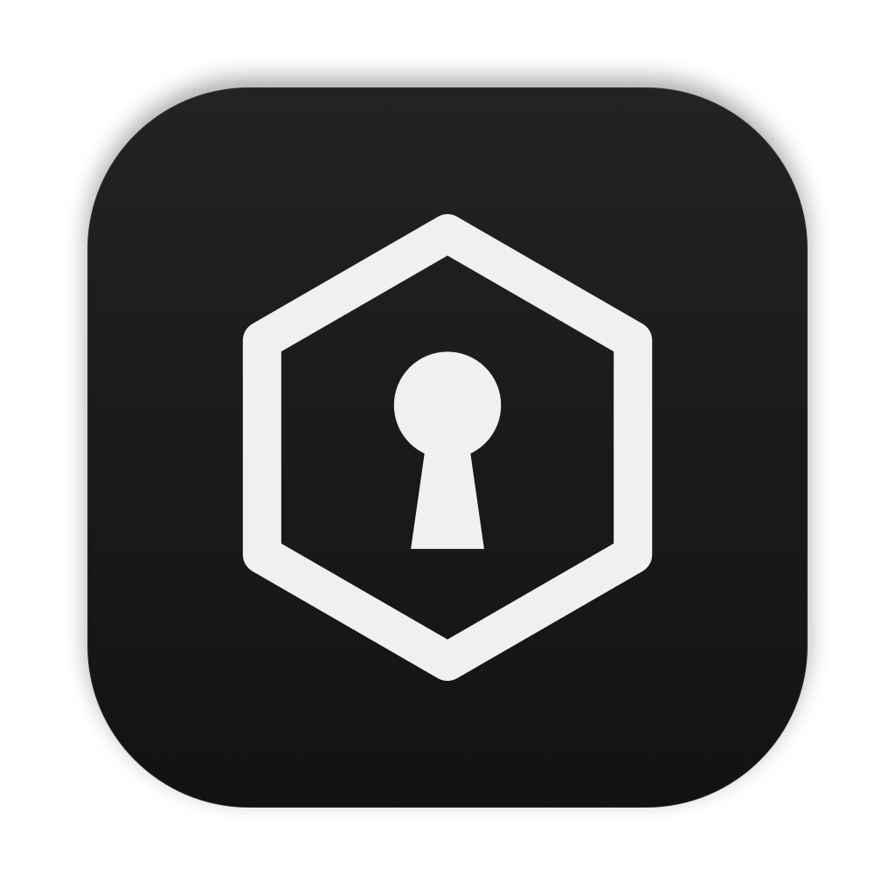
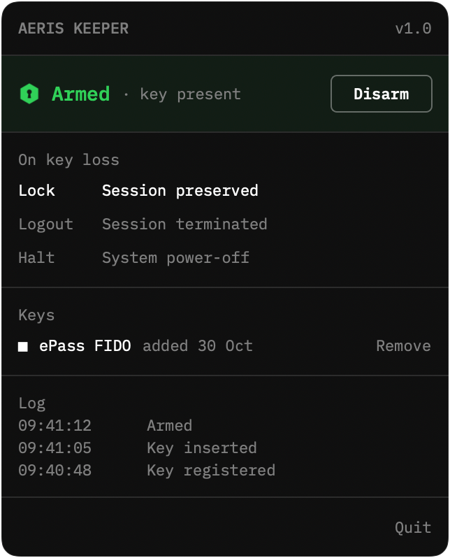

<p align="center"></p>

<h1 align="center">Aeris Keeper</h1>

<p align="center">A security key for your Mac.<br>Remove the key, the Mac locks. Unlock without it, it locks again.</p>

<p align="center"></p>

## How it works

Register any FIDO security key. One touch at registration; after that, Keeper verifies it silently each time it is
inserted. An identical model will not pass.

Arm Keeper. While a registered key is present, nothing happens. Remove it, and after 1.5 seconds the Mac locks,
logs out, or shuts down — your choice. Unlock without the key and it locks again; the attempt is kept as an incident.

Disarming, quitting while armed, changing keys and clearing incidents require the administrator password.

## Install

Download `Aeris-Keeper.zip` from [Releases](https://github.com/hjbarraza/aeris-keeper/releases/latest), unzip it, and move **Aeris Keeper** to Applications.

Keeper is not notarized by Apple, so macOS stops it the first time. Open it once, then go to
**System Settings → Privacy & Security** and choose **Open Anyway**. Afterwards it opens normally.

## Use

Insert the key, then unlock. Unlock first, and Keeper will treat you as an intruder.

Everything else — responses, incidents, recovering a lost key — is in the [guide](docs/GUIDE.md).

## Build

```sh
./build.sh
```

Produces `Aeris Keeper.app` for Apple silicon and Intel, macOS 13 or later. It lives in the menu bar, opens at login,
and always starts disarmed. Tested on macOS 27.

## Limits

- Locking uses a private macOS function.
- Keys and incidents are stored in user preferences. The administrator password is enforced by Keeper, not by the system.
- Log out and shut down can be stopped by apps with unsaved work. Lock cannot.

## License

MIT. IBM Plex Mono is licensed under the SIL Open Font License 1.1.
