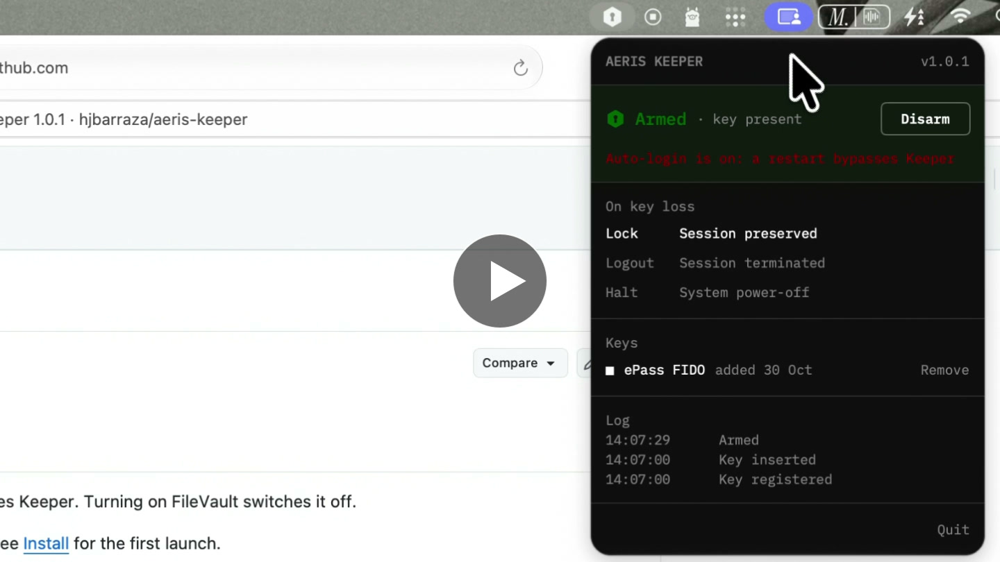

<p align="center"></p>

<h1 align="center">Aeris Keeper</h1>

<p align="center">A security key for your Mac.<br>Remove the key, the Mac locks. Unlock without it, it locks again.</p>

<p align="center"></p>

## How it works

Register any FIDO security key. One touch at registration; after that, Keeper verifies it silently each time it is
inserted. An identical model will not pass.

Arm Keeper. While a registered key is present, nothing happens. Remove it, and after 1.5 seconds the Mac locks,
logs out, or shuts down — your choice. Unlock without the key and it locks again; the attempt is kept as an incident.

Disarming, quitting while armed, changing keys and clearing incidents require the administrator password. Logging
out, restarting and shutting down do not.

<p align="center">
  <a href="https://youtu.be/xgAPX1K-7IA">
    
  </a>
</p>

## What it protects

Keeper is for being away from the desk, not a vault: it protects a session that is already open. It is not login
protection and does not encrypt anything.

Restarting the Mac ends the session, and Keeper starts disarmed — leaving only your login password. Someone who knows
that password can get in by restarting, but your session, open apps and unsaved work are gone when they do. They can
no longer slip into your open session unnoticed. With auto-login on, a restart needs no password at all; Keeper
warns you in its panel. Turning on FileVault switches auto-login off.

Your login password and FileVault are your choice; Keeper doesn't change them, and works best with both. For a key
that is required at login itself, use macOS smart card login with a PIV-capable key — or
[AerisOS](https://github.com/hjbarraza/aerisos), our Linux distribution, which can require password and key at the
login and lock screens.

## Install

Download `Aeris-Keeper.zip` from [Releases](https://github.com/hjbarraza/aeris-keeper/releases/latest), unzip it, and move **Aeris Keeper** to Applications.

Keeper is not notarized by Apple, so macOS stops it the first time. Allow it once, in any of these ways:

**Open Anyway** — any macOS version. Open Keeper, dismiss the warning, then go to **System Settings → Privacy & Security**,
scroll to Security and choose **Open Anyway**. Confirm with your password.

**Right-click → Open** — macOS 13 and 14. Right-click Keeper in Applications, choose **Open**, then **Open** again.
On macOS 15 and later this no longer works; use Open Anyway.

**Remove the quarantine flag** — from Terminal:

```sh
xattr -dr com.apple.quarantine "/Applications/Aeris Keeper.app"
```

**Allow apps from anywhere** — turns Gatekeeper off for every app, not just Keeper. Run
`sudo spctl --master-disable`, then choose **Anywhere** under **System Settings → Privacy & Security → Allow
applications from**. Undo with `sudo spctl --master-enable`.

After the first launch Keeper opens normally.

## Use

Insert the key, then unlock. Unlock first, and Keeper will treat you as an intruder.

Everything else — responses, incidents, recovering a lost key — is in the [guide](docs/GUIDE.md).

## Lost your key

Keeper always starts disarmed, so a restart gets you back in.

1. Restart the Mac. If it's locked, hold the power button until it turns off, then turn it on. Unsaved work is lost.
2. Log in with your password as usual.
3. Open Keeper, choose **Remove** next to the lost key, and confirm with the administrator password.
4. Register a new key.

Register a second key as a backup, and keep it somewhere safe. Any registered key is enough.

## Build

```sh
./build.sh
```

Produces `Aeris Keeper.app` for Apple silicon and Intel, macOS 13 or later. It lives in the menu bar, opens at login,
and always starts disarmed. Tested on macOS 27.

## Limits

- Locking uses a private macOS function.
- Keys and incidents are stored in user preferences. The administrator password is enforced by Keeper, not by the system.
- Log out and shut down can be stopped by apps with unsaved work. Keeper locks first, so the Mac stays locked if they are.
- Force Quit ends Keeper without the password. Other `kill` signals ask for it.
- A key that can only sign with a touch is recognized, not signature-checked, and is marked `*` in the panel. A
  purpose-built fake could pass as one.

## Roadmap

**Next**

- Notarized build — opens with a double-click
- Wrong passwords at the lock screen recorded as incidents
- Keeper restarts itself if force-quit while armed
- A restart while armed is recorded as an incident

**Later**

- Keys and incidents in storage only an administrator can change
- Optional: arm automatically when a registered key is inserted
- Key nicknames · VoiceOver · incident export

The detail lives in [ROADMAP.md](ROADMAP.md).

## License

MIT. IBM Plex Mono is licensed under the SIL Open Font License 1.1.
