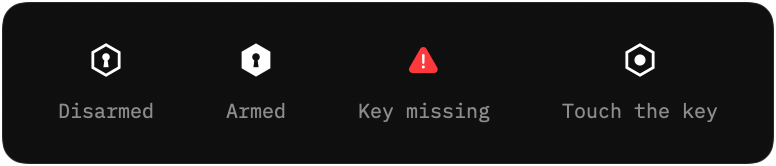

# Aeris Keeper — Guide

Keeper ties your Mac to a physical security key. While it is armed, the Mac stays usable only as long as one of
your registered keys is plugged in.

## What's included

- **Aeris Keeper.app** — a menu bar app. No Dock icon, no windows, no network access.
- **Key registration** — any FIDO security key (YubiKey, Titan, Feitian and others), verified individually,
  not just by model.
- **Three responses** to removing the key: lock, log out, or shut down.
- **Re-lock** — unlocking with the password alone locks the Mac again.
- **Incidents** — a record of every attempt, kept until an administrator clears it.
- **Administrator gate** — the actions that would weaken protection ask for the administrator password.

## Install

Download `Aeris-Keeper.zip` from [Releases](https://github.com/hjbarraza/aeris-keeper/releases/latest), unzip, and
move **Aeris Keeper** to Applications. It isn't notarized, so allow it once in **System Settings → Privacy & Security**.

Keeper appears in the menu bar and adds itself to Login Items.

## The menu bar

| Icon | Meaning |
|---|---|
| Hollow hexagon | Disarmed. Also shown before any key is registered. |
| Solid hexagon | Armed. Removing the key triggers the response. |
| Red triangle | Disarmed, and none of your registered keys is plugged in. |
| Hexagon with a dot | Waiting for you to touch the key during registration. |

Click the icon to open the panel.

## First run: register a key

1. Plug in your security key. It appears in the panel with **Register** next to it.
2. Click **Register** and enter the administrator password.
3. Touch the key when the menu bar shows the hexagon with a dot. You have 30 seconds.

The key moves to **Keys**, with the date it was added. From now on Keeper recognises that exact key every time it is
inserted, without a touch. Another key of the same model will not pass.

Register a second key as a backup the same way. Any registered key is enough to keep the Mac open.

## Arm

Click **Arm**. The status turns green and the menu bar icon turns solid.

Arm is only available while a registered key is plugged in, so you can't lock yourself out by arming without one.
Keeper always starts disarmed after a login or a restart; arm it each session.

## When the key is removed

Keeper waits 1.5 seconds, so a loose cable or a hub waking from sleep doesn't count. Then it does what you chose
under **On key loss**:

| Response | What happens |
|---|---|
| **Lock** | The screen locks. Everything keeps running. *Default, and the safest choice.* |
| **Logout** | You are logged out. Open apps quit. |
| **Halt** | The Mac shuts down. |

Logout and Halt ask apps to quit, just like the Apple menu does. An app with unsaved work can stop them, and you will
lose any unsaved work. Lock cannot be stopped and loses nothing.

## Coming back

**Insert the key first, then unlock.**

If someone unlocks with the password while no registered key is plugged in, Keeper locks the Mac again immediately
and records the attempt. That includes you, if you unlock before inserting the key.

## Incidents and the log

The bottom of the panel shows what happened.

- **Incidents**, in red, are moments when protection was tested: an unlock without a key, or an unknown security key
  inserted while armed. They are saved, survive restarts, and can only be cleared with the administrator password,
  so an intruder can't erase them. The last 20 are kept.
- **Log**, in grey, lists the last five ordinary events: keys inserted and removed, arming, registrations. It resets
  when Keeper restarts.

Keeper sends no notifications. Everything is in the panel.

## What needs the administrator password

| Action | Why |
|---|---|
| Register a key | Otherwise anyone at your desk could add their own key. |
| Remove a key | Otherwise anyone could remove yours. |
| Disarm | Otherwise protection is one click away. |
| Quit while armed | Same reason. Quitting while disarmed is free. |
| Clear incidents | So the record of an attempt can't be wiped. |

Arming never needs the password.

## If something goes wrong

**Locked out, key at hand.** Insert the key, then unlock.

**Locked out, key lost.** Restart the Mac and log in. Keeper always starts disarmed, so you get in. Then remove the
lost key from **Keys** and register a new one.

**A key shows □ in Keys.** That key is registered but not plugged in.

**Registration failed.** The key wasn't touched within 30 seconds. Click Register again.

## Uninstall

1. Disarm, then click **Quit**.
2. Remove Aeris Keeper from **System Settings → General → Login Items**.
3. Move the app to the Trash.
4. Optionally, remove its settings: `defaults delete com.aeris.keeper`

## Limits

- Locking uses a private macOS function. A future macOS could change it.
- Registered keys and incidents are stored in user preferences. The administrator password is enforced by Keeper,
  not by the system, so someone with access to your unlocked account and a terminal could edit them.
- Force-quitting Keeper with Activity Monitor bypasses the Quit password.
- macOS only reports successful unlocks, so wrong passwords at the lock screen are not recorded.
